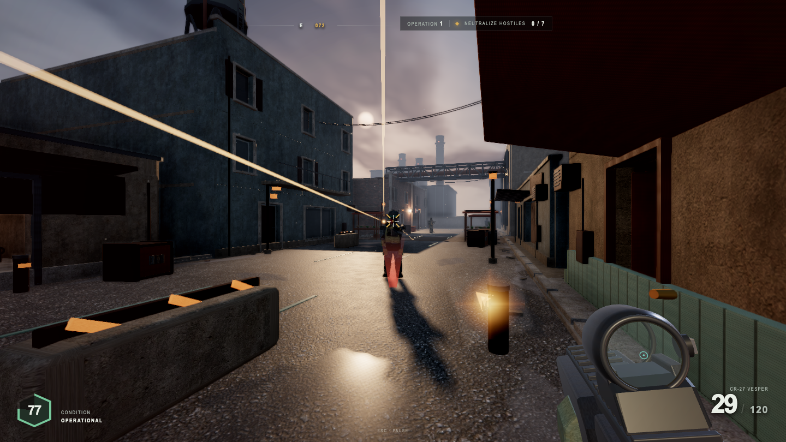
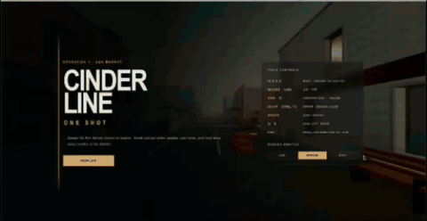
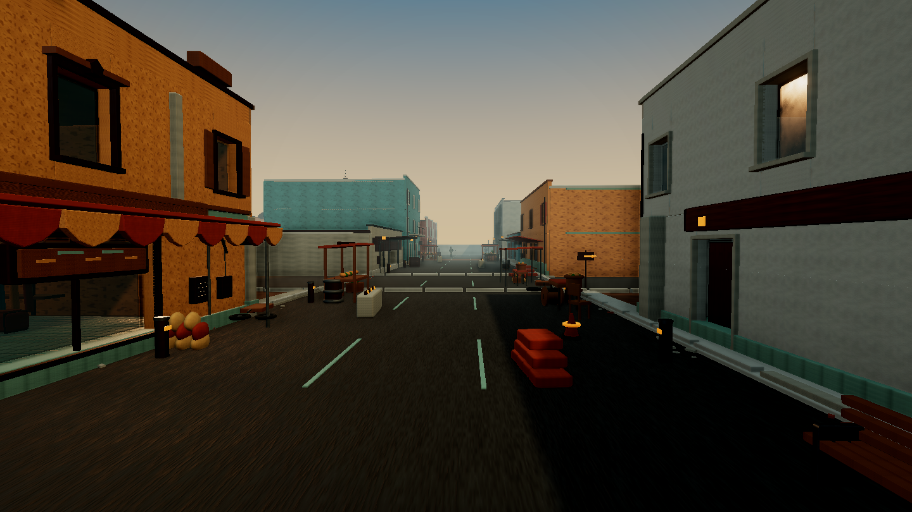
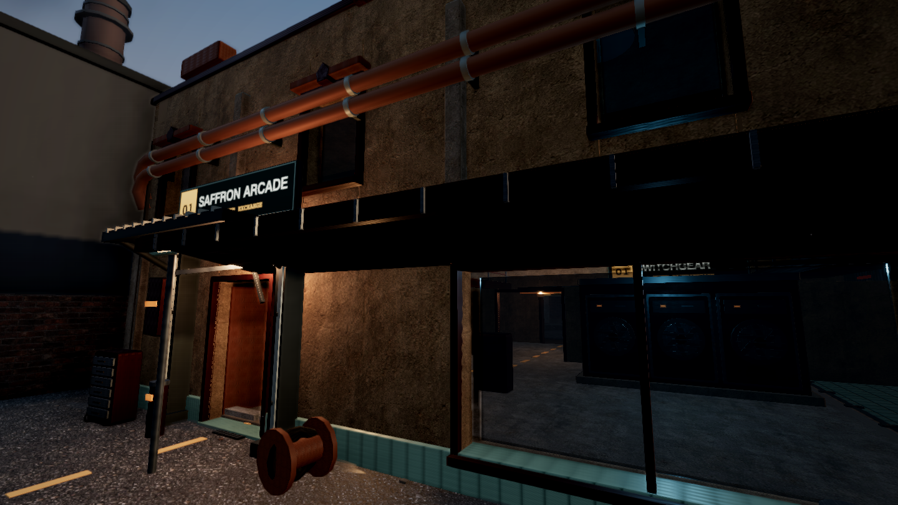
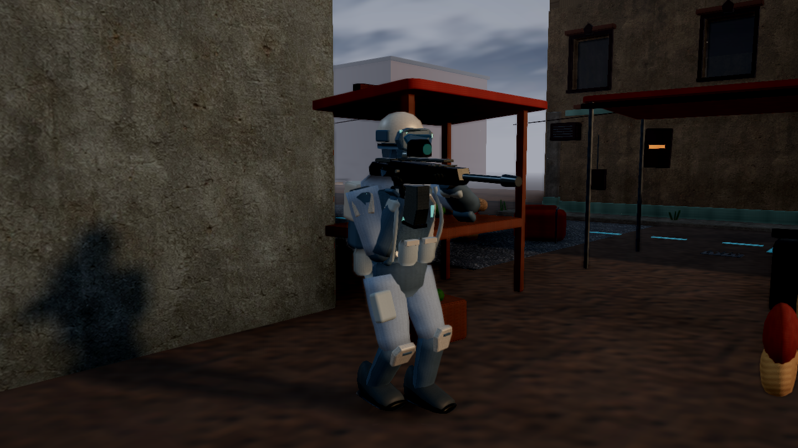

# Cinderline: One Shot

An original, deterministic browser tactical FPS built with Three.js and WebGL2.
Fight through a code-generated industrial market with projectile ballistics,
reactive combat AI, advanced first-person movement, endless operations, and
synthesized spatial audio.

**▶ [Run locally](#quick-start)** · **[Explore the gameplay](#gameplay)** ·
**[See how it was built](#ai-agent-assisted-development)** ·
**[Review the evidence](#validation-and-evidence)**

<p align="center">
  
  <br><sub><b>High-quality capture:</b> active combat rendered in the high quality preset.</sub>
</p>

<p align="center">
  
  <br><sub><b>Gameplay preview:</b> compressed for fast README loading; the capture above represents the rendered image quality.</sub>
</p>

The runtime downloads no models, textures, images, or audio samples. Buildings,
interiors, props, PBR maps, the rifle, hands, soldiers, effects, ambience, and
sound effects are all constructed from code.

## At a glance

| | |
|---|---|
| **Genre** | Single-player browser tactical FPS |
| **Engine** | Three.js `0.180.0`, WebGL2, Web Audio |
| **World** | Authored Ash Market layout with deterministic procedural assembly and dressing |
| **Simulation** | Fixed `1 / 60 s` gameplay step with isolated seeded RNG streams |
| **Progression** | Endless operations with `7 × operation` total hostiles |
| **Asset policy** | No downloaded models, textures, images, or audio samples at runtime |
| **Validation** | 22/22 automated checks, 7 deterministic captures, zero recorded browser errors |

## Gameplay

Deploy into Ash Market and neutralize every hostile before your health reaches
zero. Operation 1 begins with seven soldiers. Clearing it unlocks the next
operation on the same district with newly seeded enemy positions and a total
enemy quota of:

```text
total hostiles = 7 × current operation
```

Up to 12 enemies are active at once; reinforcements fill open slots until the
operation quota is exhausted. New operations keep enemies outside a 42 m safety
radius around the player spawn, so the player is not detected and fired upon
immediately.

The highest cleared operation is stored in versioned browser `localStorage` and
appears on the start screen after the first victory. Persisted values are treated
as untrusted input, validated, bounded, and rendered with `textContent`.
Client-only storage is convenient rather than tamper-proof; authoritative
competitive progression would require a backend.

## Feature highlights

- **Tactical enemy perception** — soldiers detect only within a 35° half-angle,
  38 m range, and unobstructed line of sight. Approaching from behind remains
  unseen until sound or repositioning exposes the player.
- **Humanized return fire** — first detection has a deterministic 2–4 second
  reaction window. Aim turns and tracks with inertia; angular spread, burst
  bloom, suppression, and player movement produce both hits and misses.
- **Projectile combat** — travel time, gravity, body zones, headshots,
  penetrable materials, shallow-angle metal ricochets, tracers, decals,
  surface-specific impacts, and directional damage feedback.
- **Advanced movement** — sprint, crouch, slide, jump, protected lean, slopes,
  and grounded low-step traversal. The capsule may step or mantle only up to
  0.44 m, preventing tall props and buildings from lifting the player onto roofs.
- **Reactive enemies** — patrol, investigate, pursue, use cover, reposition,
  fire, reload, react to hits, buckle when killed, fall fully to the ground, and
  despawn after a short delay.
- **Code-generated presentation** — procedural architecture and props, a
  separate first-person viewmodel scene, pooled combat effects, post-processing,
  and Web Audio synthesis with HRTF positioning.

## Visual tour

<table>
  <tr>
    <td width="50%">
      
      <br><sub><b>Ash Market:</b> authored layout, procedurally assembled façades and street dressing.</sub>
    </td>
    <td width="50%">
      
      <br><sub><b>Generated architecture:</b> layered façades, materials, signage, props, and weathering.</sub>
    </td>
  </tr>
  <tr>
    <td colspan="2" align="center">
      
      <br><sub><b>Combat AI:</b> procedural soldier rig with perception, movement, aiming, damage, and death states.</sub>
    </td>
  </tr>
</table>

Seven reproducible 1440×810 captures are tracked in
[`artifacts/captures/`](artifacts/captures/). Their manifest records the seed,
quality preset, SHA-256 hashes, combat state, and browser diagnostics.

## Controls

Click **Deploy** first to enable pointer-lock aiming and browser audio.

| Input | Action |
|---|---|
| `W A S D` | Move |
| Mouse | Look / aim |
| Hold `LMB` | Fire |
| Hold `RMB` | Aim down sights |
| `R` | Reload |
| Hold `Shift` while moving forward | Sprint |
| Hold `Ctrl` or `C` | Crouch |
| Sprint + `Ctrl` / `C` | Slide |
| `Space` | Jump; mantle a valid ledge up to 0.44 m |
| `Q` / `E` | Protected lean left / right |
| `Esc` | Release pointer lock and pause |
| Menu buttons | Resume, restart, advance operation, or change quality |

## Quick start

Requirements:

- Node.js **20.19.0 or newer**
- npm
- A desktop browser with JavaScript, WebGL2, pointer lock, keyboard, and mouse

```bash
git clone https://github.com/YiTaChen/fps_sol_one_shot.git
cd fps_sol_one_shot
npm ci
npm run dev
```

Open `http://127.0.0.1:5173`. Vite may select the next free port if 5173 is
already occupied.

For a reproducible high-quality run:

```text
http://127.0.0.1:5173/?seed=20364033&quality=high
```

Valid quality values are `low`, `medium`, and `high`.

### Production build

```bash
npm run build
npx vite preview
```

The ES2022 build is written to `dist/`, includes source maps, and separates
Three.js into its own chunk.

## AI-agent-assisted development

The project was built in two directed development passes on **2026-07-28** and
**2026-07-29** with an OpenAI Codex coding agent. The author supplied the
creative brief, acceptance criteria, play-test feedback, and product decisions;
the agent implemented the systems, drove browser verification, generated
evidence, and committed each completed milestone to GitHub.

| Milestone | Scope delivered | Commit evidence |
|---|---|---|
| Engine foundation | Fixed-step loop, deterministic RNG streams, event bus, renderer, input, diagnostics | [`6d9273c`](https://github.com/YiTaChen/fps_sol_one_shot/commit/6d9273c) |
| Complete combat loop | Player controller, rifle, projectiles, enemies, world, UI, audio, victory and defeat | [`044cf73`](https://github.com/YiTaChen/fps_sol_one_shot/commit/044cf73) |
| Visual and combat polish | Architecture, weapon and soldier rigs, materials, effects, spatial feedback | [`e1714d6`](https://github.com/YiTaChen/fps_sol_one_shot/commit/e1714d6) |
| Quality hardening | Hero art, collision, browser checks, deterministic captures, performance and visual review | [`914fdc6`](https://github.com/YiTaChen/fps_sol_one_shot/commit/914fdc6), [`49ed58f`](https://github.com/YiTaChen/fps_sol_one_shot/commit/49ed58f) |
| Fair enemy combat | Directional vision, LOS, reaction delay, gradual tracking, spread, return fire, corpse lifecycle | [`1653804`](https://github.com/YiTaChen/fps_sol_one_shot/commit/1653804) |
| Safe traversal | Strict capsule collision, grounded low-step rules, tall-wall and jump bypass prevention | [`53606ba`](https://github.com/YiTaChen/fps_sol_one_shot/commit/53606ba) |
| Endless operations | Same-map enemy reseeding, safe spawns, `7 × operation` scaling, local highest record | [`eed7b24`](https://github.com/YiTaChen/fps_sol_one_shot/commit/eed7b24) |

The iteration loop mirrored the
[`3d-battle-documentaries`](https://github.com/YiTaChen/3d-battle-documentaries)
workflow: implement a visible milestone, exercise it in a real browser, inspect
screenshots and diagnostics, add deterministic regression coverage, then commit
and push before beginning the next stage. Git history records the milestones;
exact agent token totals and complete wall-clock time are not encoded in the
repository, so they are not estimated here.

## Architecture

`Game` is the composition root and owns the state machine and subsystem
lifecycle:

```text
main.js
└── Game
    ├── core: fixed clock, named RNG streams, events, diagnostics
    ├── rendering: world scene, viewmodel scene, lights, post-processing
    ├── materials + world: generated maps, architecture, props, colliders
    ├── player + physics: capsule, slopes, jump, slide, mantle, lean
    ├── rifle + projectiles + pooled effects
    ├── enemy director + procedural soldier rigs
    ├── Web Audio synthesis
    └── DOM HUD, menus, progression, and result screens
```

Key engineering properties:

- Gameplay simulation runs at a deterministic fixed step and rendering is
  interpolated separately.
- World and first-person weapon render through separate scenes and cameras.
- Sibling systems communicate through a small synchronous event bus.
- Named RNG streams isolate world dressing, AI, weapon spread, effects, and
  audio variation.
- Restart reuses the renderer, AudioContext, DOM shell, and global listeners.
- Geometry, materials, and hot combat effects use shared resources and fixed
  pools.

The runtime catalogs 12 building specifications, 8 façade families, 4
enterable interiors, 34 architectural modules, 40 prop archetypes, and 19
material families. The full technical contract is in
[`ARCHITECTURE.md`](ARCHITECTURE.md).

## Quality presets

| Preset | Render scale | DPR cap | Shadow map | SSAO / bloom | Fog range |
|---|---:|---:|---:|---|---:|
| Low | 82% | 1.0 | 1024 | Off | 84 |
| Medium | 100% | 1.25 | 1536 | On | 105 |
| High | 100% | 1.75 | 2048 | On, stronger bloom | 128 |

Effect pools also respond to quality changes. Procedural material textures are
128 px on Low and 256 px on Medium/High.

## Validation and evidence

```bash
npm run build
npm test
npm run capture
npm run profile
```

| Evidence | Result |
|---|---|
| Production build | Vite build succeeds with 47 transformed modules |
| Contract and browser suite | **22/22 passed in 267.35 s** |
| Enemy AI contract | 35° cone boundary, 2–4 s reaction, aim lag, mixed spread hits/misses |
| Physics contract | 10 high-wall, low-step, ceiling, airborne, landing, and controller cases |
| Progression contract | Hostile storage input, monotonic records, deterministic operation seeds |
| Full gameplay loop | Real two-way combat, victory, Operation 2 with 14 total / 12 active, defeat, restart |
| Browser diagnostics | Zero console errors, page errors, failed requests, or HTTP errors |
| Capture set | 7 deterministic 1440×810 views with hashes and zero browser errors |

Evidence files:

- [`artifacts/tests/smoke-report.json`](artifacts/tests/smoke-report.json)
- [`artifacts/captures/manifest.json`](artifacts/captures/manifest.json)
- [`artifacts/performance/moving-combat.json`](artifacts/performance/moving-combat.json)
- [`artifacts/visual-review.md`](artifacts/visual-review.md)

The recorded performance profile runs headless Chromium through SwiftShader
software WebGL. It completed the full moving-combat workload but did **not**
meet the 45 FPS target on that runner, so it is preserved as automation evidence
rather than presented as representative hardware-GPU performance.

### Reproducing selected evidence

```bash
FPS_CAPTURE_VIEWS=wide-street,active-combat npm run capture
FPS_BASE_URL=http://127.0.0.1:5173 npm test
```

`FPS_CAPTURE_SEED`, `FPS_CAPTURE_DIR`, and the same `FPS_BASE_URL` override are
supported by the capture and profile scripts.

<details>
<summary><strong>Scope and known limitations</strong></summary>

- Desktop WebGL2 and pointer-lock controls are required; touch, gamepad, and
  accessibility-specific input modes are not implemented.
- The game is single-player, single-map, and single-rifle. Operations scale on
  the same authored district rather than adding new maps.
- Highest-operation persistence stores no sensitive data and is not tamper-proof
  against DevTools, extensions, or local browser-profile modification.
- Browser audio starts only after a user gesture.
- Live quality switching does not regenerate procedural material textures.
- The visual review found a coherent procedural prototype, but not professional
  military-FPS art quality. Remaining weaknesses include simplified forms,
  mannequin-like anatomy and hand contact, repetitive surfaces, and a few
  visibly floating props.
- Capture hashes document generated outputs; they are not pixel-diff regression
  tests.
- Vite assumes root-path hosting. Subpath deployment requires an appropriate
  `base` setting.
- No license has been granted in this repository.

</details>
